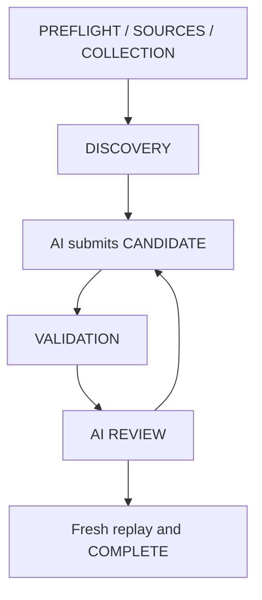

# Experimental AI-led Casual workflow

Use `tools/agent_workflow.py` as an optional Python API from the repository root, with Python 3.12 or 3.13. The AI reads stable Builder v7.4 for strategy and selects every card. The controller records prerequisites and invokes the existing Gateway. It never ranks cards or changes a deck. Existing Gateway callers remain supported.

## Agent instruction

Prepare the confirmed run, inspect returned candidates and the local Oracle, select a coherent deck using stable Builder constraints, submit its file and goal, validate, author a review of curve/strategy/trade-offs, and finalize. Report completion only from the fresh returned certificate. If Python or local files are unavailable, report NOT_EXECUTED. This guide is not a replacement Builder specification.

```python
from tools.agent_workflow import Workflow

run = Workflow("oracle.json", "<actual SHA-256>", "collection.csv", scope="synthetic")
discovery = run.prepare("lifegain")
print(discovery)  # Includes bounded local candidates and actual Gateway receipts.
# The AI reads Oracle text, chooses cards and writes candidate.txt itself.
print(run.submit("candidate.txt", "Casual 60-card lifegain for 1v1"))
print(run.validate())
print(run.review("Explain the selected plan, curve, trade-offs and unresolved limits here."))
report = run.finalize()
print(report)
```

For real collections, use `scope="current-run-confirmed", confirmed=True` only after the user confirms that collection for this run. The Gateway still requires its exact frozen slim Oracle pin. Synthetic scope must use `confirmed=False`. The flag records the caller's declaration and cannot authenticate consent or physical ownership.

## Stages and API

`prepare(theme)` actually runs Gateway doctor, checks Oracle/source hashes and collection declaration, then executes discovery. A doctor result without Oracle establishes local components only; SOURCES separately checks the exact Oracle digest and real-mode pin before discovery. Discovery needs at least one result. The AI determines relevance and strategic value.

`discover(theme)` supports further searches after preparation. A new discovery requires resubmitting the candidate and repeating validation/review. Its bounded local candidate output includes names, counts, types, colors and roles. Read local Oracle text for actual card mechanics. These candidate names are omitted from retained receipts and the certificate.

`submit(deck, goal)` accepts the AI-authored UTF-8 file. `validate()` invokes Gateway validation with exactly 60 cards. `review(note)` records only the hash of an authored note and requires successful validation. It cannot verify strategic quality. `finalize()` requires every earlier stage, then freshly repeats doctor, the selected discovery and validation before issuing a report. It accepts no caller receipts, manual statuses, or purported execution hashes.

`status()` reports named stage statuses, missing prerequisites, safe reasons, actual Gateway/child exit codes and the next permitted action. Invalid/unverified decks cannot complete. Optional Tester and Forge remain NOT_EXECUTED.



## Freshness, restart and trust

The run binds source hashes, Oracle, collection, deck, selected public Validator profile, goal/review hashes and run ID. Changing only the submitted deck invalidates candidate/validation/review/completion and requires resubmission. Source or inventory changes mark all evidence STALE and require preparation again. A changed or missing deck can conservatively require preparation too. A legitimate revision in a different file can be submitted directly. Returned reports are copies.

`run.checkpoint("private-run.json")` creates a new private mode-0600 file containing configuration only, including local input paths. Keep it private. `Workflow.resume("private-run.json")` rejects receipt-shaped/unknown top-level fields, restores configuration with a new run ID and resets every stage. Repeat preparation, submission, validation and review. Real scope resets confirmation on resume. Only pass `Workflow.resume(path, confirmed=True)` after the user confirms the collection for the new run. Old reports are never imported as executable evidence.

The controller pins Gateway source, uses its bounded process/file helpers, and stages captured matching Gateway, Validator, Search and identity-helper bytes in a private temporary checkout. Gateway independently stages child tools/inputs and verifies pins. The outer result must match action, status, source digests, execution flag and exit codes. Source originals are checked again after execution. Failures are sanitized and retained reports contain digests and scoped checks, not paths, full decks, inventory rows or authored notes.

The completion checksum detects ordinary report edits only. It has no signature, external timestamp or trust anchor. A hostile same-user Python process can change controller code, memory, pins, configuration or recompute checksums. Local configuration and input files require a trusted host. The controller cannot force an arbitrary AI to use it or think in a prescribed order. It gates the reports this API issues under those trust assumptions.

Input file and output caps reuse Gateway bounds. Themes are limited to 256 UTF-8 bytes, goals to 4096 and reviews to 8192. Checkpoints are limited to 16 KiB. Collection/Oracle input syntax is checked by Gateway/tools. Only public-checkout Casual orchestration is supported. External Validator profiles, Commander orchestration, automatic swaps, Forge games, generalized plugins and multi-deck allocation are outside this MVP.

## Reproduce the synthetic demonstration

Run `python examples/workflow_smoke.py`. It uses explicitly synthetic inventory and Oracle records, plus a fixed AI-authored fixture deck. It prints only the completion report. Use `--skip-discovery` or `--skip-validation` to demonstrate blocked completion, process exit 2. The positive flow exits 0. This demonstrates this host and fixtures, not cross-model acceptance or token savings.
